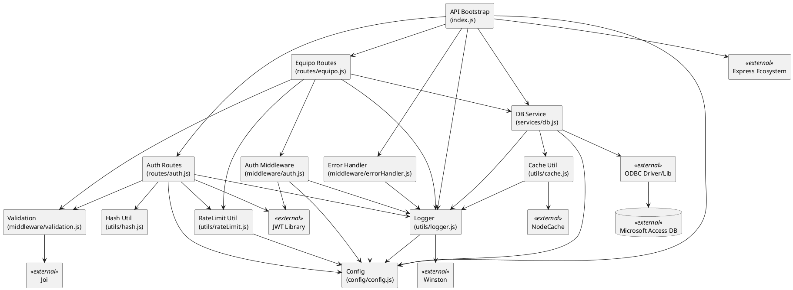

# Diagrama de Componentes UML - API

Este documento describe los componentes principales de la API y sus dependencias para construir un **diagrama de componentes UML**.

## 1) Componentes principales

### API Core
- **`index.js` (App/Bootstrap)**
  - Inicializa Express.
  - Configura middlewares globales (`helmet`, `cors`, `compression`, `express-rate-limit`).
  - Registra rutas (`/api/v1/equipo`, `/api/v1/auth`, `/api/v1/status`).
  - Inicializa la base de datos mediante `services/db`.
  - Gestiona apagado ordenado (graceful shutdown).

### Configuracion
- **`config/config.js` (Configuration Provider)**
  - Expone variables de entorno (puerto, path de BD, secretos JWT, limites de intervalos).
  - Provee parametros a casi todos los modulos.

### Rutas / Controladores HTTP
- **`routes/auth.js` (Auth Controller)**
  - Endpoint `POST /login`.
  - Valida entrada (`pin`), aplica rate limit de login, verifica hash de PIN y firma JWT.
- **`routes/equipo.js` (Equipo Controller)**
  - Endpoint `GET /:sn`.
  - Exige autenticacion JWT.
  - Valida `sn`, aplica rate limit por serial y consulta datos en BD.

### Middlewares
- **`middleware/auth.js` (Authentication Middleware)**
  - Extrae y valida token `Bearer`.
  - Carga usuario en `req.user`.
- **`middleware/validation.js` (Validation Service)**
  - Define esquemas `Joi` para `sn` y `pin`.
  - Funcion generica `validate(...)`.
- **`middleware/errorHandler.js` (Global Error Handler)**
  - Captura errores no controlados.
  - Registra logs y genera respuesta estandar de error.

### Servicios de infraestructura
- **`services/db.js` (Database Access Service)**
  - Inicializa y administra pool ODBC.
  - Ejecuta consulta de equipo por serial.
  - Ofrece health check y cierre de pool.
  - Usa cache para lecturas frecuentes.

### Utilidades transversales
- **`utils/logger.js` (Logging Component)**
  - Logger central con Winston (consola + archivos).
- **`utils/hash.js` (Hashing Utility)**
  - Genera/verifica SHA-256 para autenticacion por PIN.
- **`utils/rateLimit.js` (Application Rate Limiter)**
  - Rate limit en memoria por clave y tipo (`request`/`query`).
- **`utils/cache.js` (Caching Component)**
  - Cache en memoria con TTL para resultados de consulta.

### Dependencias externas (para UML como componentes externos)
- **Express Ecosystem:** `express`, `cors`, `helmet`, `compression`, `express-rate-limit`
- **Seguridad/Auth:** `jsonwebtoken`, `crypto`
- **Datos:** `odbc`, Microsoft Access Driver
- **Validacion:** `joi`
- **Observabilidad:** `winston`
- **Cache:** `node-cache`

## 2) Relaciones de dependencia (alto nivel)

1. `index.js` depende de:
   - `config/config.js`
   - `utils/logger.js`
   - `services/db.js`
   - `middleware/errorHandler.js`
   - `routes/auth.js`
   - `routes/equipo.js`

2. `routes/auth.js` depende de:
   - `middleware/validation.js`
   - `utils/hash.js`
   - `config/config.js`
   - `utils/logger.js`
   - `utils/rateLimit.js`
   - `jsonwebtoken` (externo)

3. `routes/equipo.js` depende de:
   - `middleware/auth.js`
   - `middleware/validation.js`
   - `services/db.js`
   - `utils/logger.js`
   - `utils/rateLimit.js`

4. `middleware/auth.js` depende de:
   - `config/config.js`
   - `utils/logger.js`
   - `jsonwebtoken` (externo)

5. `middleware/errorHandler.js` depende de:
   - `utils/logger.js`
   - `config/config.js`

6. `services/db.js` depende de:
   - `config/config.js`
   - `utils/logger.js`
   - `utils/cache.js`
   - `odbc` (externo)

7. `utils/cache.js` depende de:
   - `config/config.js` (importado)
   - `utils/logger.js`
   - `node-cache` (externo)

8. `utils/logger.js` depende de:
   - `config/config.js`
   - `winston` (externo)

9. `utils/rateLimit.js` depende de:
   - `config/config.js`

## 3) Interfaces/puertos sugeridos para UML

Para un diagrama de componentes UML mas limpio, puedes modelar estas interfaces:

- **`IAuthService`**
  - `login(pin): token`
- **`IEquipoQueryService`**
  - `getEquipoBySerial(sn): Equipo[]`
- **`IAuthValidator`**
  - `verifyToken(token): Claims`
- **`IValidationService`**
  - `validate(input, schema): ValidationResult`
- **`IDatabaseService`**
  - `initializePool()`, `queryEquipo(sn)`, `checkHealth()`, `closePool()`
- **`ICacheService`**
  - `get(key)`, `set(key, value)`, `invalidate(key)`
- **`ILogger`**
  - `info()`, `warn()`, `error()`, `debug()`
- **`IRateLimitService`**
  - `checkRateLimit(key, type): boolean`

## 4) PlantUML base (componente)

Puedes usar este bloque como punto de partida:

## 5) Notas de modelado

- El endpoint `/api/v1/status` puede modelarse como interfaz provista por `API Bootstrap` que consume `IDatabaseService.checkHealth()`.
- Hay dos capas de control de trafico:
  - Rate limit global por `express-rate-limit`.
  - Rate limit de negocio por `utils/rateLimit.js`.
- `services/db.js` aplica estrategia de cache-aside (`get` -> consulta -> `set`).
- La autenticacion es stateless basada en JWT.
